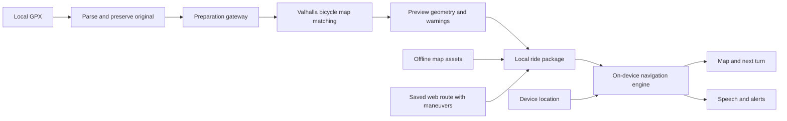

# Ride Maker mobile plan

Status: extension plan; an initial mobile viewer and foreground guidance already exist. Functionality first; visual design follows a
successful real-device navigation test. Sol owns architecture, task contracts,
integration, and review. Gemini Flash implements individual task briefs. Gemini
is run in a separate T3 thread; it is not available through Sol's subagent tools.

## Goal and first release

Import a cycling GPX, review its generated directions, download the ride, and
follow it with visual and spoken turns. Navigation must work without reception
and with the screen locked during an explicitly started ride.

Include local route import, route preview, preparation warnings, download
status, start/pause/resume/end, next maneuver and distance, remaining distance,
voice prompts, and off-route alerts. No account is required for a local GPX.
Support both platforms structurally, but validate the owner's phone first.
First test platform is pending confirmation; this does not block scaffolding.

Defer automatic rerouting, on-device routing graphs, ride social features,
advanced training statistics, and the visual redesign. Offline route following
is distinct from offline rerouting. A force-quit app is not guaranteed to keep
navigating; report and recover interrupted sessions when it is reopened.

## Existing foundation

- npm workspaces and Turbo already cover `apps/*` and `packages/*`.
- `apps/web` is the Vite route planner, using MapLibre GL JS.
- `apps/mobile` already uses Expo 57, React Native 0.86, MapLibre 11, foreground
  Expo Location, Expo Speech, and keep-awake. It can open shared route links and
  list public routes. It currently uses native React Native UI, not shared RSD.
  It has no local GPX import, durable offline downloads, or background guidance.
  Its navigation helper and tests live in `apps/mobile/src/navigation.*`.
  Existing progress is clamped forward and ignores fix timestamps; replace those
  limitations through reviewed contracts, rather than treating it as field-ready.
- `packages/ui` uses React Strict DOM and shared design tokens.
- `packages/domain` stores segments, control points, and indexed maneuvers.
- `packages/gpx` imports tracks/routes and exports GPX; imported files have no
  generated maneuvers, and current GPX export omits maneuver data.
- `packages/routing` requests bicycle routes and retains Valhalla instructions.
  It currently uses a public endpoint, not a self-hosted service.
- PocketBase stores route documents. The current persistence API supports
  creating unlisted routes, listing public routes, and fetching a shared route, not a complete personal
  route library or mobile authentication workflow.

## Stack and ownership

| Component | Choice and responsibility |
| --- | --- |
| `apps/mobile` | Existing React Native/Expo app; TypeScript; add Expo Router when screen structure needs it |
| General UI | React Strict DOM; reuse shared primitives and tokens |
| Platform UI | Native navigation, safe areas, gestures, dialogs, file import |
| Map | MapLibre React Native; native map and offline packs |
| Location | Expo Location and TaskManager; native fallback if the device spike requires it |
| Audio | On-device speech behind an adapter; native audio/session handling if necessary |
| Local persistence | Expo SQLite for metadata/session state; filesystem for original GPX and route assets |
| Shared logic | Existing packages plus a new pure-TypeScript `packages/navigation` |
| Route preparation | A small TypeScript `apps/api` gateway to self-hosted Valhalla |
| Cloud routes | Existing PocketBase, added after local navigation works |
| Map assets | OSM-derived vector tiles from a source explicitly allowing offline downloads |

Audit the existing Expo/React Native/MapLibre pins before adding RSD. Preserve
the current workspace instead of scaffolding a replacement. The web app's React and RSD versions must be checked against Expo
requirements; do not assume all current pins can remain identical. Verify that
workspace resolution does not introduce duplicate React runtimes. Reuse UI
pieces, not the planner screen layout. The current browser font-family token
needs a native-compatible font strategy.

## Data flow and boundaries

The ride package preserves the original import separately from matched geometry.
It contains a versioned route snapshot, maneuver offsets, preparation warnings,
map-pack references, units, and preparation metadata. A ride's route snapshot is
immutable while navigation is active; edits create a new prepared version.

Validate coordinates, segment lengths, and maneuver indexes at boundaries.
Shared-link data currently receives only shallow validation; strengthen it
before accepting it as executable navigation data. Evolve saved-route schemas
with explicit compatibility handling; existing web routes must continue opening.

SQLite owns downloaded-ride records and session checkpoints. A ride download
becomes ready only after its route, instructions, and required map assets have
completed successfully. Interrupted downloads resume or remain visibly incomplete.
GPS and audio tasks do not depend on a mounted React screen. Persist progress and
announced maneuver IDs so background/foreground transitions do not repeat cues.

## GPX preparation

Use Valhalla `trace_route` with bicycle costing for instructions, supplemented
by matching attributes where needed to assess gaps and deviations. Do not route
between the GPX endpoints and call that a faithful import.

Preserve separate GPX segments, their direction, and discontinuities. Handle
large inputs using bounded simplification/chunks with overlap, reconcile shape
indexes and maneuvers at boundaries, and never silently bridge a gap. Test loops,
out-and-back tracks, and intersections at chunk boundaries before accepting this.

Compare matched geometry with the original over the whole trace. Keep explicit
warnings for unmatched sections and substantial deviations; choose thresholds
using real cycling fixtures, not an invented universal confidence score. The
user reviews deviations before accepting a prepared ride. If a segment cannot
be matched, retain its original line and clearly identify where turn guidance
is unavailable; never replace it with an unexplained detour.

Known fresh Ride Maker routes can reuse validated stored maneuvers. A basic
route-only GPX with sparse points may need the user to choose between following
its literal geometry and constructing a bicycle route through those points.

## Navigation contract

Sol defines and reviews the concrete interfaces before implementation. Keep
the engine independent of React, Expo, network requests, and storage:

- Input: immutable prepared ride, previous navigation state, a timestamped
  location fix with accuracy/speed/heading where available, and configuration.
- Output: updated serializable state and events for an upcoming turn, immediate
  turn, off-route/rejoined, degraded GPS, and arrival.
- Track segment and along-route distance, next maneuver, lateral distance, GPS
  quality, and announced cue identifiers. Timers use fix timestamps or an
  injected clock so recorded rides can be replayed deterministically.

Projection uses recent progress, direction, and plausible movement to distinguish
overlapping paths. A nearest-point-only approach must not jump to the wrong lap
or return leg. Reject stale fixes and implausible jumps. Weak GPS should degrade
confidence rather than trigger instant off-route alarms. Use hysteresis and
several reliable fixes for leaving/rejoining, without permanently assuming
progress only moves forward: wrong turns, reversal, and rejoining must work.

Turn timing considers distance, speed, nearby maneuvers, and accuracy. Emit each
cue once unless the rider intentionally requests a repeat. Define explicit
pause/resume/end and restart behavior. Arrival requires progress to the correct
route ending, especially when start and finish overlap.

## Milestones and acceptance

| Order | Deliverable | Acceptance gate |
| --- | --- | --- |
| 0 | Existing mobile audit and native feasibility spike | Install on target phone; render native map and RSD button; persist timestamped fixes; speak cues during a 20-minute locked-screen outing; stop the ride and confirm tracking/audio stop |
| 1 | Prepared-ride contracts and pure navigation engine | Replay fixtures for clean ride, wrong turn, GPS drift, parallel path, loop, reversal, pause/resume, and arrival; assert maneuver sequence, cue deduplication, and correct progress |
| 2 | GPX preparation API and regional Valhalla | At least five representative cycling GPXs; preserve original; expose deviations and unmatched gaps; stable indexes; input limits/timeouts; no silent route substitution |
| 3 | Local mobile ride workflow | Pick a GPX, preview preparation, save locally, start/pause/resume/end; inspect next maneuver and off-route state; reopen and recover an interrupted session |
| 4 | Offline maps and dependable audio | Download then relaunch in airplane mode; map and turns work with screen locked; test Bluetooth, silent mode, music interruption, missing voice assets, and interrupted downloads |
| 5 | Web-to-phone handoff | Open saved-route links; retain existing maneuvers; persist downloaded route offline; add mobile OAuth and secure token storage only where account features require them |
| 6 | Field validation and design pass | Complete representative real rides; record GPS gaps, cue failures, battery consumption, and fixes before polishing visuals |

Milestone 0 uses a bundled prepared fixture to exercise location/audio without
waiting for Valhalla or production tiles. Its background spike is evidence, not
the finished navigation algorithm. Locked-screen audio may require a native
module; decide from the spike instead of assuming `expo-speech` is sufficient.
Record device/OS/build, permission states, observed update gaps, audio behavior,
and battery consumption. Simulators and replay tests cannot satisfy field gates.

For milestone 2, start with a regional OSM extract covering actual test rides.
Choose coverage before provisioning; no planet-wide import initially. Document
tile generation, resource requirements, updates, attribution, and recovery.
The API enforces request-size/point limits, timeouts, concurrency bounds, rate
limits, and structured errors. Do not expose unrestricted expensive Valhalla
requests publicly. Production must not depend on a public demo routing endpoint.
Server changes require matching server-config docs and live verification.

Map packs contain the route area plus surrounding coverage and supported zooms.
Check tile/style/font/sprite offline behavior and provider terms explicitly;
do not bulk-download from OSM's public standard tile server. Account sync and
network calls never become prerequisites for an already-downloaded ride.

## Model handoffs

Keep the canonical plan and task briefs in this Git repository. Obsidian is an
optional project-note view and is not a build dependency. Sol issues one bounded
task at a time with owned files, interfaces, acceptance checks, and escalation
conditions. Gemini reports files changed, commands run, failures, and unresolved
issues. Sol reviews the diff and results before accepting a milestone.

Start with [task 001](tasks/001-background-spike.md), extending the existing mobile app. Do not independently change
architecture, schema versions, routing semantics, or production deployment.
Escalate incompatibilities with evidence rather than installing unrelated
libraries or repeatedly retrying a failing approach.

## Primary references

- [React Strict DOM Expo setup](https://react.github.io/react-strict-dom/learn/setup/)
- [MapLibre React Native setup](https://maplibre.org/maplibre-react-native/docs/setup/getting-started/)
- [Expo background location](https://docs.expo.dev/versions/latest/sdk/location/)
- [Expo speech behavior](https://docs.expo.dev/versions/latest/sdk/speech/)
- [MapLibre offline packs](https://maplibre.org/maplibre-react-native/docs/modules/offline-manager/)
- [Valhalla map-matching API](https://github.com/valhalla/valhalla/blob/master/docs/docs/api/map-matching/api-reference.md)
- [OSM standard tile policy](https://operations.osmfoundation.org/policies/tiles/)
